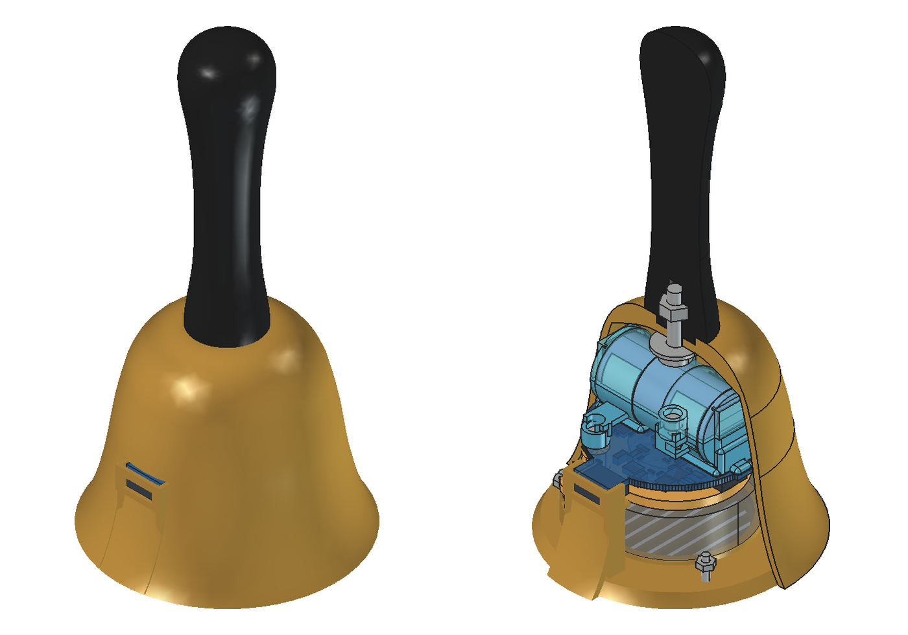
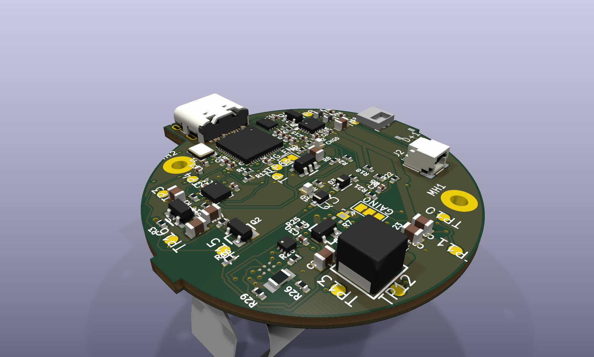
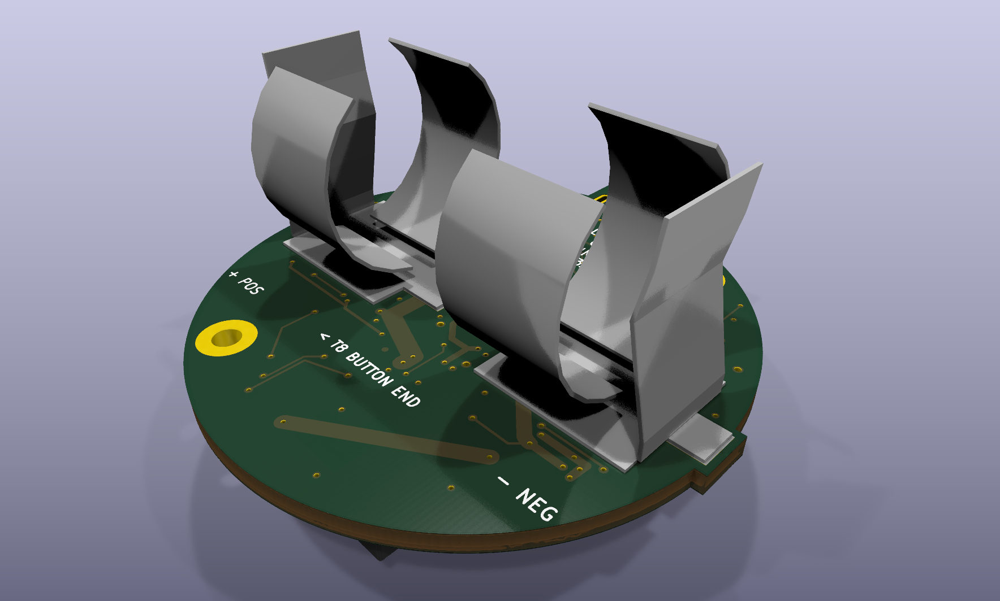

# Digital Handbell

**A real ringing gesture. A digitally voiced bell. An open design to build together.**

We're developing a rechargeable, motion-triggered musical instrument with a
local speaker, custom electronics, and a removable cartridge inside a
3D-printed bell. The goal is expressive, affordable music-making without a
phone or computer during play.

[Project site and 3D board](https://dcuccia.github.io/digital-handbell/) ·
[Build a handbell](docs/build-a-handbell.md) ·
[Explore the design](docs/design-gallery.md) ·
[Roadmap](docs/roadmap.md) ·
[Join the project](CONTRIBUTING.md) ·
[Documentation](docs/README.md)

*Enclosure concept, not a product photograph. These preserved CAD views
predate the latest six-layer PCB; fitting that board and its speaker
connector into the assembly is still on the roadmap.*

## Where we are

**November 2026: the six-layer PCB has reached zero unconnected items, and
the first prototype PCBA batch has been ordered.** The next step is turning
those boards into a reviewed, working instrument.

| Ready to explore | Still to do |
|---|---|
| Native KiCad schematic, routed PCB and local libraries | Electrical/DFM review and disposition of remaining rule findings |
| FreeCAD enclosure/cartridge studies and inert fit-print files | Updated assembly for the six-layer board, connector/harness clearance and physical fit |
| Prototype PCBA order placed with JLCPCB (quoted as 10 PCBs, 8 assembled) | Incoming inspection: confirm substitutions, via fill, placements and polarity on arrival, then staged bring-up |
| Firmware, audio and gesture requirements | Implement and demonstrate a sounding instrument; measure latency, noise and runtime |

This is **an engineering prototype, not a build-ready kit**. Ordering
first articles is how we find out what works; it is not a fabrication
release or safety approval. Zero opens means the connectivity check found
no unconnected items; it does not prove the circuit works. The public
snapshot retains 291 non-open DRC findings
and 46 schematic-parity findings. Electrical, mechanical, manufacturing
and safety review remain open. No child-use qualification is claimed.

[Board review and remaining risks](docs/pcb-review-2026-11.md) ·
[Order package](hardware/handbell/quote-prep/2026-11-09-six-layer/README.md) ·
[Incoming checks](hardware/handbell/quote-prep/2026-11-09-six-layer/unresolved-before-ordering.md)

## Inside the design

| Subsystem | Current direction |
|---|---|
| Processing | RP2040 with 2 MB QSPI flash; CircuitPython is the planned firmware path |
| Motion | LSM6DSOX six-axis accelerometer/gyroscope for ringing and damping experiments |
| Sound | MAX98357A I2S amplifier, TPS61023 boosted audio rail and a 40 mm speaker |
| Power and service | Rechargeable 1S Li-ion design, cell protection, USB-C charging/programming and debug access |
| Electronics | Six copper layers; 83 fitted parts: 81 front-side electronic parts and two rear battery contacts |
| Enclosure | Original printed shell, black handle and removable speaker/PCB/cell cartridge |

The intended behavior is local and offline: recognize a ringing gesture,
play a bell sound, and stay quiet between notes. Natural damping,
velocity response, note selection and reliable gesture detection are
development goals, not demonstrated features. Wireless is a future option,
not a dependency of the first instrument.

### The ordered PCBA

| Front: electronics | Back: battery clips |
|:---:|:---:|
|  |  |

*KiCad renders of public snapshot `2f738ccb`, not photographs. Package
models and disclosed stand-ins are used; the battery clips and J1 speaker
connector are simplified project proxies. This is not a fit check.*
**[Rotate it in 3D on the project site](https://dcuccia.github.io/digital-handbell/)** ·
[Build a handbell](docs/build-a-handbell.md) ·
[More views](docs/design-gallery.md)

## Explore without getting lost

| I want to... | Start here |
|---|---|
| See the bell and board | [Design gallery](docs/design-gallery.md) or the [3D project site](https://dcuccia.github.io/digital-handbell/) |
| Build one: parts, printing, harness, assembly | [Build a handbell](docs/build-a-handbell.md) |
| Open the latest electronics | [Six-layer review snapshot](hardware/handbell/iterations/printed-bell-six-layer-review/README.md) |
| Open the enclosure or find STEP/STL files | [Mechanical asset guide](mechanical/README.md) |
| Understand what is next | [Roadmap](docs/roadmap.md) |
| Help with a specific part | [Contributing](CONTRIBUTING.md) |
| Understand the circuits and intended behavior | [Architecture](docs/architecture.md) and [firmware/audio plan](docs/firmware-and-audio.md) |
| Find older experiments or engineering evidence | [Documentation index](docs/README.md) and [hardware revision guide](hardware/handbell/iterations/README.md) |

Keep the whole checkout when opening CAD: some library paths reference
sibling directories. KiCad 10.0.6 and FreeCAD 1.1.3 have been exercised.
No CAD installation is needed to browse the gallery or plans.

## Come build with us

There is useful work for software developers, electronics reviewers,
mechanical designers, musicians and curious first-time contributors.
Near-term needs include CircuitPython/audio experiments, motion replay
tools, PCB review, the updated cartridge fit, and clear assembly/test
documentation. You do not need to route a PCB to help.

Pick a workstream in the [contribution guide](CONTRIBUTING.md), or introduce
your idea in an [issue](https://github.com/dcuccia/digital-handbell/issues).
We track work in the [project board](https://github.com/users/dcuccia/projects/1)
and keep decisions and evidence in the repository.

## Open design, with attribution

The electronics adapt published Adafruit designs, including the RP2040
Prop-Maker Feather, LSM6DSOX breakout and TPS61023 MiniBoost. Original
software, documentation and mechanical work use MIT; adapted hardware
retains **CC BY-SA 3.0**. Mixed CAD exports and images retain their
electronics attribution. See [ATTRIBUTION.md](ATTRIBUTION.md) for the
per-asset boundaries; this is not an Adafruit-endorsed product.

The [2023 design notes](Design%20Notes.md) and
[system diagram](System%20Diagram.pptx) remain preserved. The
[research and routing history](docs/README.md#history-and-research)
records how we reached the current design without making every experiment
the starting point for a new contributor.
