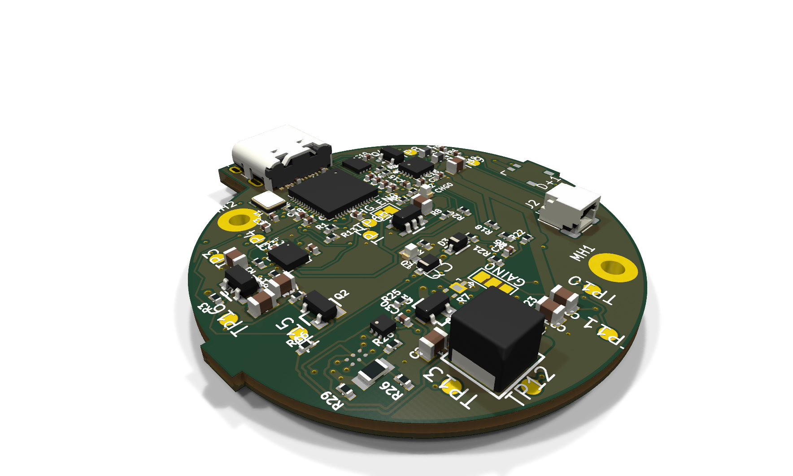
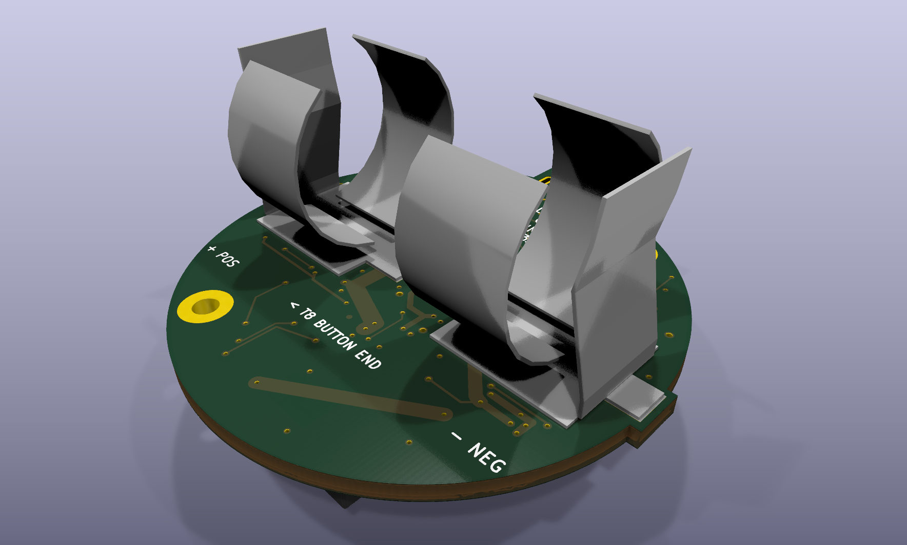
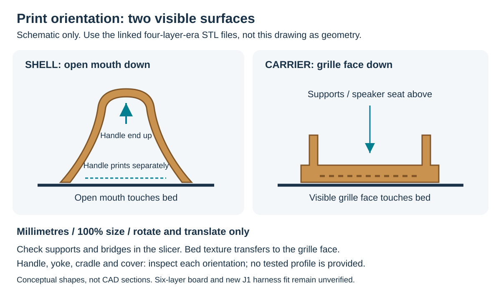
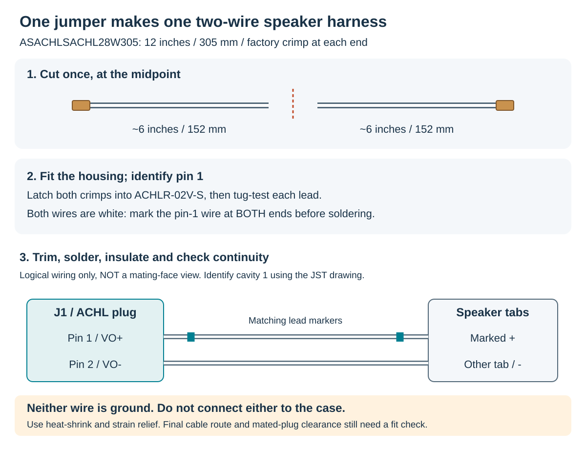
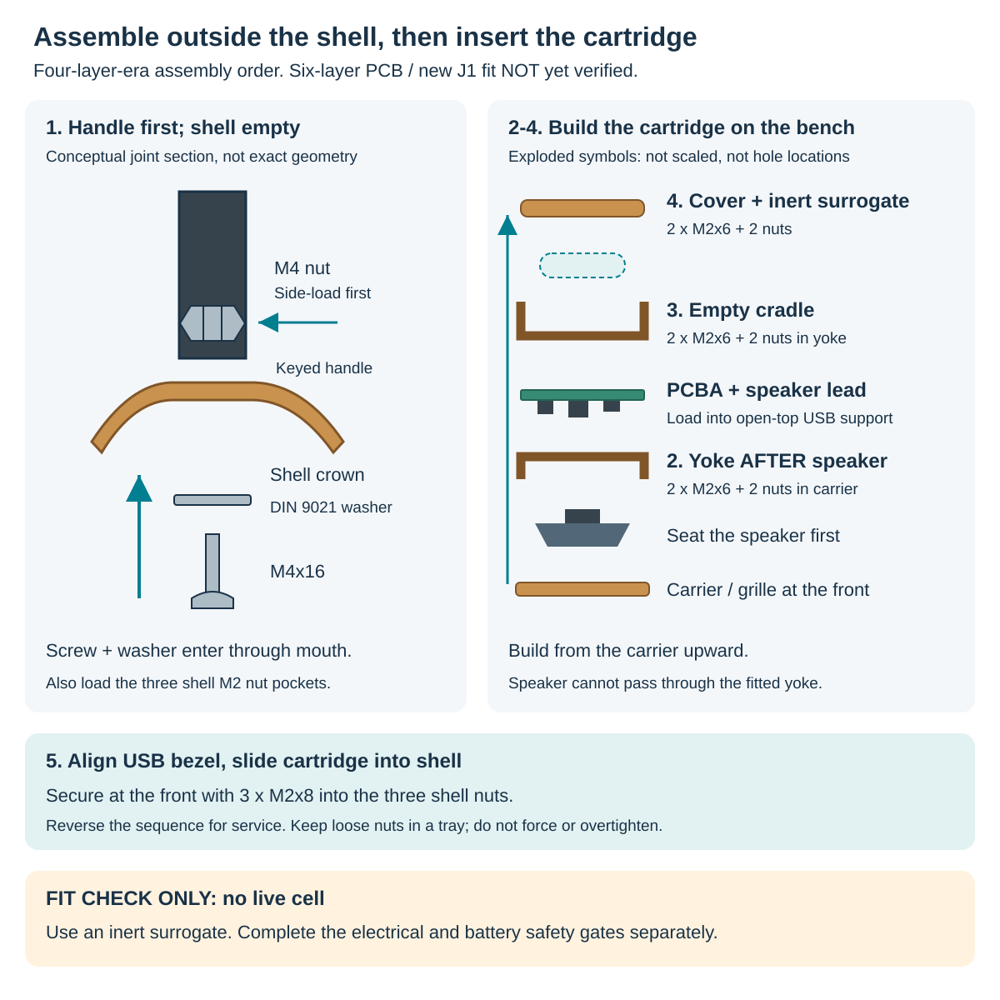

# Build a handbell

The go-to page for turning an assembled PCBA into a working prototype
handbell: what to buy, what to print, how to make the speaker lead and the
order of assembly.

> **Prototype status (November 2026).** Eight PCBAs are on order (10 boards,
> 8 assembled). Nothing on this page has been built with the six-layer board
> yet. The printed parts and hardware below come from the completed
> **four-layer** fit model; they have not been re-checked against the
> six-layer board or the new flush speaker connector. This is a design
> review build for adults at the bench, **not a child-use kit**. Read the
> [safety gates](#battery-and-safety-gates) before inserting a cell.

Quick links: [interactive 3D PCBA](https://dcuccia.github.io/digital-handbell/3d/) ·
[project landing page](https://github.com/dcuccia/digital-handbell#readme) ·
[PCB review](pcb-review-2026-11.md) ·
[quote package](../hardware/handbell/quote-prep/2026-11-09-six-layer/README.md)

## 1. What one handbell needs

| Electronics side | Battery-contact side |
|:---:|:---:|
|  |  |

*Identify the supplied PCBA: snapshot `2f738ccb`. These are renders with
package models and simplified J1/clip proxies, not assembly or fit proof.
[Rotate the board](3d/) or see [image sources and limits](design-gallery.md).*

| Group | Per bell | Notes |
|---|---|---|
| PCBA | 1 assembled six-layer board | Includes both battery clips (BT1/BT2, C6993377) and the board-side speaker header J1 (JST BM02B-ACHLKS-GAN-ETF, C594367) |
| Printed parts | 6 pieces | Shell, handle, carrier/grille, yoke, cell cradle, cell cover ([section 3](#3-print-the-parts)) |
| Speaker | 1 Gikfun EK1794, 4 ohm, 40 mm | Measured D40/H19 unit |
| Speaker lead | 1 two-wire harness | JST ACHL 1.2 mm pitch ([section 4](#4-make-the-speaker-lead)) |
| Fasteners | 6 M2x6, 3 M2x8, 9 M2 nuts, 1 M4x16 pan head + M4 nut + DIN 9021 washer | [section 2](#2-procurement-for-eight-bells) |
| Cell | 1 Vapcell T8 16340 button-top | **Only after** the safety gates |

## 2. Procurement for eight bells

November 10 planning list; no purchases made unless noted. Supplier
fulfillment still needs incoming inspection. Mechanical quantities follow
the retained printed-bell assembly, **not an updated six-layer fit approval**.

| Item | Per bell | Eight bells / suggested purchase |
|---|---|---|
| Bell filament | Shell (and optionally other visible parts) | **Ordered:** [ERYONE silk PLA+, bronze](https://www.amazon.com/dp/B082XTFB7T). See [section 3](#3-print-the-parts) |
| Handle filament | Handle | Black, non-silk filament is the working choice; a material name alone does not establish strength |
| Speaker plug | One JST **ACHLR-02V-S** housing | 8 needed; buy 10. [DigiKey 455-2890-ND](https://www.digikey.com/en/products/detail/jst-sales-america-inc/ACHLR-02V-S/5272191) |
| Speaker pre-crimped leads | Two **SACHL-003G-P0.2** terminated 28 AWG leads | Buy 10 [ASACHLSACHL28W305 double-ended 12-inch jumpers (DigiKey 455-3258-ND)](https://www.digikey.com/en/products/detail/jst-sales-america-inc/ASACHLSACHL28W305/8107431). Cut each in half for 20 approximately 6-inch (152.4 mm) leads, enough for 10 two-wire harnesses (8 needed + 2 spares) |
| Speaker | One 4 ohm Gikfun EK1794 | 8 needed minus stock; one spare is useful. Do not silently substitute another 40 mm driver. The seller's 3 W title conflicts with its 2 W description; output limits are unqualified |
| Cell | One **Vapcell T8 16340 button-top**, 850 mAh typical, 4.2 V full, rated 3 A continuous ([manufacturer page](https://www.vapcelltech.com/h-pd-60.html?fromMid=470); [retail lead](https://www.18650batterystore.com/products/vapcell-16340-t8-850mah-3a-button-top-battery), stock/price unverified) | Buy **2 evaluation samples first** with insulating cases; 8 + 2 spares only after dimensions, retention and electrical tests pass |
| Internal screws | Six M2x6, ISO 4762-style cap head | 48 needed; buy 60 or a 100-pack. Head screen D3.8/H2 mm |
| Front cartridge screws | Three M2x8 | 24 needed; buy 30 or a 50-pack; match the recessed head envelope |
| M2 hex nuts | Nine, DIN 934-style AF4/H1.6 mm | 72 needed; buy 100. Check the printed captive-pocket fit |
| Handle joint | One M4x16 pan head, one M4 hex nut, one DIN 9021 washer (OD12/ID4.3/about 1 mm) | 8 sets; buy 10. M4x20 and 8-32 are **not** substitutes |
| Consumables and bench tools | Heat-shrink, lead markers, solder/flux, insulated cell cases, USB-C data cable, DMM, current-limited supply | Shared; not fitted PCB parts. SWD recovery uses the fine probe land, not a fitted header |

## 3. Print the parts

**Files.** Use the completed model in
[`mechanical/studies/2026-09-13-printed-bell/imu-four-layer-review/extended-run/`](../mechanical/studies/2026-09-13-printed-bell/imu-four-layer-review/extended-run/):

| Print | STL | Suggested filament |
|---|---|---|
| Shell (one piece, D70/H55.8, crown and three cartridge lugs) | `INERT-shell.stl` | Bronze silk PLA+ |
| Handle (80 mm, keyed) | `INERT-black-handle.stl` | Black |
| Flush grille / speaker carrier | `INERT-flush-carrier.stl` | Bronze silk or black |
| Speaker yoke | `INERT-yoke.stl` | Any PLA (hidden) |
| Cell cradle | `INERT-cell-cradle.stl` | Any PLA (hidden) |
| Cell cover | `INERT-cell-cover.stl` | Any PLA (hidden) |

The other `INERT-*` files (PCBA, cell, speaker) are fit dummies, not prints.
STEP versions and the editable FreeCAD assembly sit in the same folder.
Do not use the mixed-face `development` folder or the incomplete parent
`imu-four-layer-review` files.

**Orientation.** STLs keep assembly coordinates: import in millimetres at
100%, then translate/rotate, **never scale**. Print the **shell mouth-down,
handle-up** and the **grille face-down** so the visible faces stay clean;
bed texture transfers to the grille face. The crown slopes, nut-pocket
roofs, the raised USB surround and the handle side tunnel need support or
bridging review in your slicer. The wide mouth gives access to remove
internal supports before assembly.

*Orientation guide, not a support recipe or exact CAD section. The handle
is a separate print; "handle-up" means the shell's handle end points upward.*

**Starting settings for ERYONE silk PLA (0.4 mm nozzle).** Manufacturer
range: nozzle 190-220 C, bed 55-70 C, 30-60 mm/s (the TDS says 30-100 mm/s).
Project starting point for the bell: **0.12 mm layers, 215 C, 60 C bed,
30 mm/s outer walls**. Higher temperature and slower walls increase sheen.
A small curved test comparing 0.12 vs 0.16 mm and 210/215/220 C is worth
doing before a full shell. These are unexercised starting values, not a
tested printer profile; details and sources are in
[material and handle notes](printed-bell-material-and-handle.md).

**Material limits.** Silk PLA is chosen for appearance. Its heat-distortion
temperature is about 53 C (TDS): do not leave a bell in a hot car or charge
it in the sun. Silk appearance does not qualify strength, creep or impact
resistance for the handle and screw bosses. Do not over-tighten M2/M4
screws into printed parts.

## 4. Make the speaker lead

Parts per harness: one ACHLR-02V-S housing and one ASACHLSACHL28W305
double-ended 12-inch jumper from the [procurement list](#2-procurement-for-eight-bells).
Cutting it in half provides two approximately 6-inch, pre-crimped 28 AWG
leads with SACHL-003G-P0.2 contacts (note the `L`: older notes say
`SACH-003G`, which is not the selected contact). Six inches is the selected
starting lead length for this small enclosure; trim to the actual route
during the fit check. The
[JST drawing](https://www.jst.com/wp-content/uploads/2025/06/eACHL.pdf)
specifies AWG 30-28 and insulation OD 0.50-0.63 mm; its 2 A rating is with
AWG 28.

1. Cut the 12-inch jumper in half, retaining one factory-crimped contact
   on each half; no contact crimping tool is needed.
2. Insert two contacts into the housing in the correct orientation until
   they latch; tug-test each one.
3. Both wires are white: **mark pin 1** at both ends.
4. Trim to length, strip and solder to the speaker tabs, pin 1 to the
   speaker's marked positive tab. Add heat-shrink and strain relief.
5. Check continuity: J1.1 (VO+) to speaker +, J1.2 (VO-) to the other tab.
   Neither lead is ground, so never tie either to a ground or case.

*Logical wiring, not a connector-face drawing. Do not infer left/right
cavity numbering or crimp insertion orientation from this diagram; use
the linked JST drawing. The blue bands represent added lead markers,
not supplied wire colours.*

A vendor-made harness is fine if it uses these exact parts, the polarity
above and a measured length. Generic "JST 1.2 mm" cables are not
equivalent. Plug body and wire-exit clearance at the new J1 location
remain open.

## 5. Assemble

Follow this order. It matches the completed fit model; reverse it to service.
Keep loose nuts in a tray.

1. With the shell empty, side-load the handle nut, fit the keyed handle and
   insert the washer and M4x16 upward through the mouth. Press the three
   shell M2 nuts into their roofed pockets.
2. Outside the shell, put nuts in the carrier, seat the **speaker first**,
   then fit the yoke with two M2x6 screws. The speaker cannot pass through
   the yoke afterward.
3. Put nuts in the yoke, lower the PCBA into the open-top USB support, plug
   in the speaker lead, then add the empty cradle with two M2x6 screws.
4. **No live cell yet.** For a fit check, install a cell surrogate, the
   cover nuts and the cover with two M2x6 screws.
5. Align the USB bezel, slide the cartridge into the shell and fit the
   three front M2x8 screws.

*The sequence and hardware follow the completed four-layer fit model.
Shapes and gaps are schematic, not dimensioned part drawings. The six-layer
board, mated J1 plug and wire route still require mechanical integration.
Use the actual STL/STEP files for part geometry.*

Board firmware and audio bring-up are tracked in
[firmware and audio](firmware-and-audio.md) and the
[validation plan](validation-plan.md).

## Battery and safety gates

The T8 is an **unprotected** lithium-ion cell. The PCB has a BQ29700
protection stage, but the system has not been qualified.

- First power the board from a **current-limited bench supply**, not a cell,
  and verify protection and charge behaviour.
- The charger has no automatic cell-temperature cut-off, and there is no
  reverse-insertion protection. Check polarity every time.
- Shorting the loose cell's terminals bypasses the PCB protection. Store
  cells in individual insulating cases.
- Vapcell lists 16.4 x 34.0 mm but warns a button top can add 2-3 mm.
  Get the seller's maximum **finished button-top** length and diameter;
  do not assume the flat-top envelope.
- CR123A primaries, LiFePO4 RCR123 cells and longer protected/USB-charging
  16340 cells are **not** substitutes.
- The MCP73831 charger is programmed for about 196 mA (nominal). The
  project has not approved unattended charging or use by children.

Sources: [cell and protection review](t8-electrical-revision.md),
[contact and cell geometry](battery-contact-options.md),
[speaker selection](mechanics-and-manufacturing.md),
[printed-bell revision](printed-bell-revision.md) and the
[printed-bell study guide](../mechanical/studies/2026-09-13-printed-bell/README.md).

Illustration provenance: [design gallery](design-gallery.md#assembly-instruction-diagrams)
and [source manifest](images/showcase/sources.json). These original instruction
diagrams do not incorporate supplier screenshots or manufacturer artwork.
