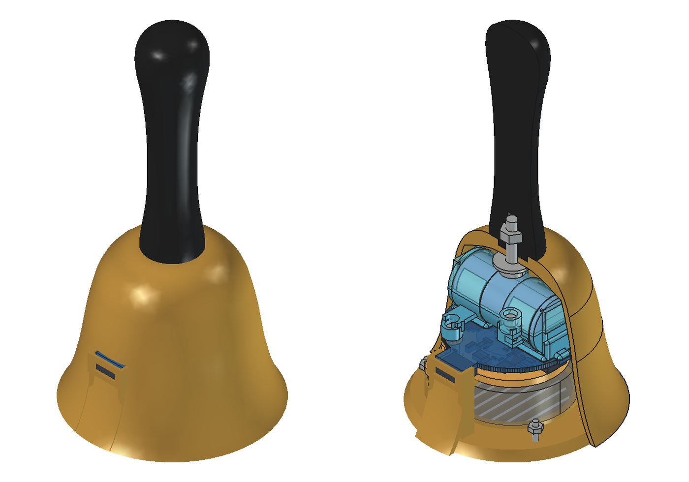
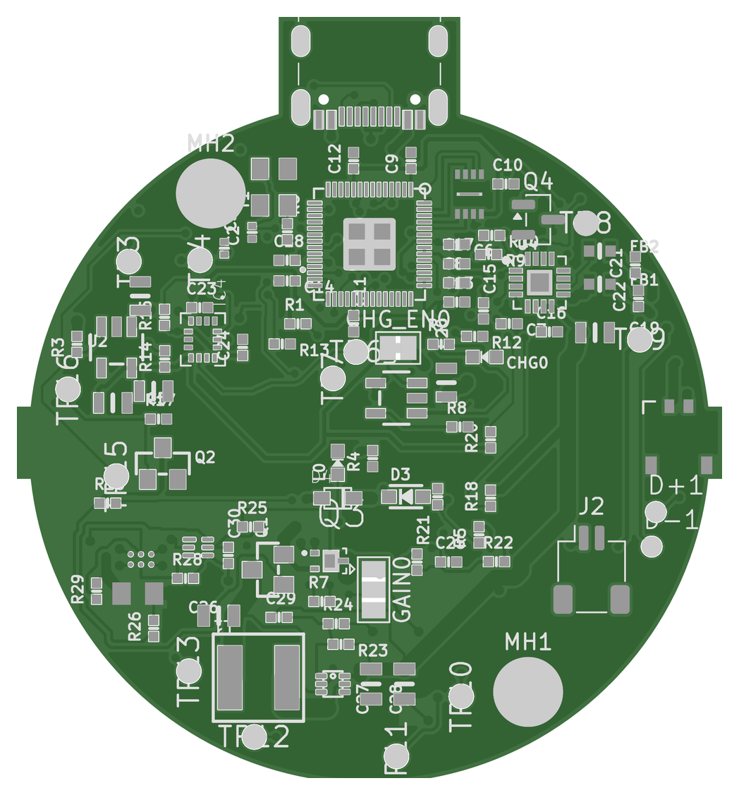
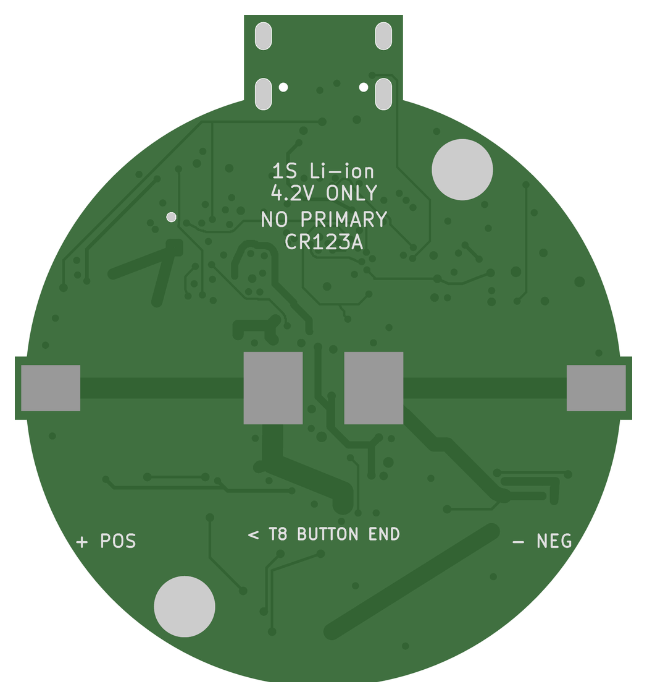
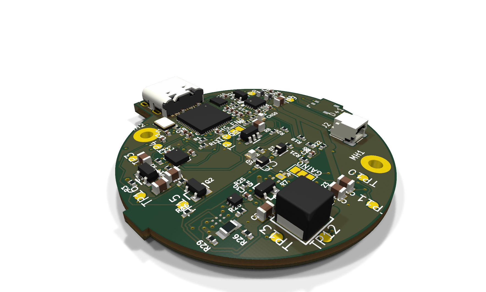
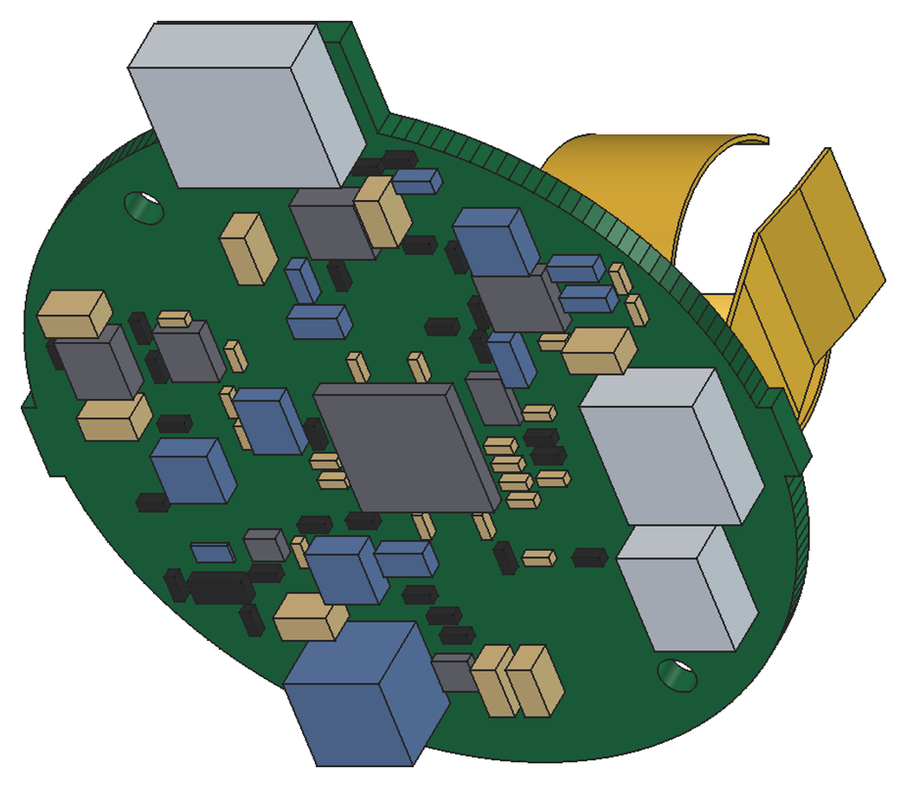
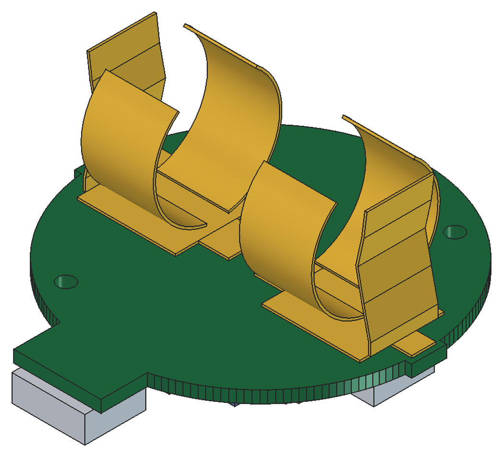

# Design gallery

[Project home](../README.md) · [Roadmap](roadmap.md) · [Hardware](../hardware/README.md) · [Mechanical files](../mechanical/README.md)

The electronics and enclosure are at different revisions. The **six-layer
PCB is the current electrical review target**; the most recent completed
full assembly still uses a four-layer-era board. None of these images is
a photograph of a functioning prototype or evidence of manufacturing fit.

## The bell concept

An original printed shell, black handle, outward-facing speaker and
removable electronics/battery cartridge. The pictured model has a
70 mm shell diameter, 55.8 mm body and 80 mm handle. These are authored
CAD dimensions, not qualified tolerances or current-six-layer fit claims.
The colours are CAD display choices, not measured filament appearance.

These views come from the preserved **power-rework assembly**
(`2a923489` FreeCAD source), not the later IMU assembly or today's PCB.
The later USB-skin correction is not represented in this image.
[Original views and source record](../mechanical/studies/2026-09-13-printed-bell/views/render-source.json)
remain unchanged.

## Current six-layer board

| Front: electronics side | Rear: battery-contact side |
|:---:|:---:|
|  |  |

These are project-generated Gerber illustrations for **public PCB
`2f738ccb`**, the source of the November quote. They show copper, mask and
silkscreen without fitted component bodies. The renderer omitted Excellon
drills because its parser could not read the exported slot syntax; grey
mounting pads therefore must not be interpreted as solid undrilled lands.
Use the native board and drill evidence for geometry inspection. Display
colours do not specify the selected ENIG surface finish.

[Open the KiCad snapshot](../hardware/handbell/iterations/printed-bell-six-layer-review/README.md) ·
[Review findings](pcb-review-2026-11.md) ·
[Quote/export recipe](../hardware/handbell/quote-prep/2026-11-09-six-layer/README.md)

[Open the interactive 3D visualization](3d/). It adds package-form models
and disclosed USB-C/inductor stand-ins to a scratch copy; the exact J1
speaker connector and rear battery contacts are omitted. It is not a
mechanical-fit or assembly check.

## Populated PCBA: recent renders of an earlier board

| Component side | Rear contacts |
|:---:|:---:|
|  |  |

These PCBA-only views were rendered during the November 9-10 review
session from the completed **September 24 IMU assembly** (`b2dff347`
FreeCAD source, four-layer PCB `d2a098b0`). They were previously only in
session scratch storage. The component bodies are engineering proxies,
not manufacturer STEP models; copper routing is not shown.

They **do not show the latest placement or JST ACHL J1**. The six-layer
assembly update must include that connector's mated plug and wire exit,
not just the board outline. This is a concrete contribution opportunity in
[#5](https://github.com/dcuccia/digital-handbell/issues/5), not a fit claim.

## Download or inspect the models

| Asset | Open |
|---|---|
| Current electronics | [KiCad project](../hardware/handbell/iterations/printed-bell-six-layer-review/handbell.kicad_pro), [schematic](../hardware/handbell/iterations/printed-bell-six-layer-review/handbell.kicad_sch) |
| Most recent completed assembly (older PCB) | [FreeCAD](../mechanical/studies/2026-09-13-printed-bell/imu-four-layer-review/extended-run/printed-bell.FCStd), [complete STEP](../mechanical/studies/2026-09-13-printed-bell/imu-four-layer-review/extended-run/printed-bell-complete.step) |
| Same older populated board alone | [STEP with contacts](../mechanical/studies/2026-09-13-printed-bell/imu-four-layer-review/extended-run/full-populated-pcba.step) |
| Inert prints and source/evidence selection | [Mechanical asset guide](../mechanical/README.md) |

Keep a full checkout for relative libraries and source records. Use copies
when experimenting, and import STL in millimetres at 1:1. Older fit
prints are not live-cell restraints or a ready-to-build six-layer kit.

## Image provenance

The [showcase manifest](images/showcase/sources.json) binds source and
published-image hashes, model/PCB revisions and image transformations.
The only presentation changes are white-margin cropping, proportional
resizing and combining the two enclosure views. No geometry was repaired,
removed or synthesized for the gallery. Original assets stay in place.

All views are project-generated from the documented design. Original
mechanical work remains MIT; the depicted adapted electronics retain their
CC BY-SA 3.0 context and [Adafruit credits/notices](../ATTRIBUTION.md).
No JLCPCB account screenshots, supplied vendor-model previews or private
backup records are republished. Consult the attribution policy before
reusing a mixed assembly as if it were entirely MIT.
