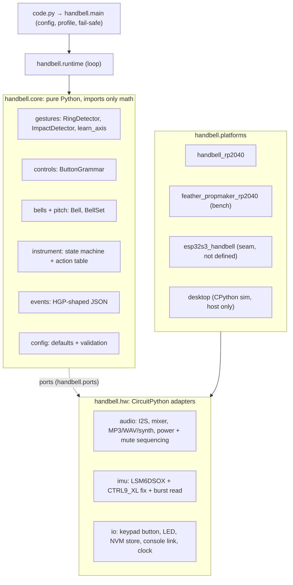

# Firmware architecture

[Firmware guide](../../firmware/README.md) · [Bring-up](bring-up.md) · [Audio assets](audio-assets.md) · [Gesture tuning](gesture-tuning.md)

**Implemented November 2026 in [`firmware/`](../../firmware/README.md);
not yet run on the custom board.** This page explains the structure and the
reasons for it. Behavior claims stay limited to what the tests show until
bench evidence exists.

## Goals

1. **Day one on RP2040 with CircuitPython.** The subsystems were chosen
   because Adafruit ships proven CircuitPython support for them. The firmware
   uses `audiobusio`, `audiomixer`, `audiomp3`, `audiocore`, `synthio`,
   `keypad` and `adafruit_lsm6ds` **unmodified** and builds on top.
2. **A thin seam for ESP32-S3.** CircuitPython exposes the same APIs on S3,
   so a new target is a pin table, a capability flag and optionally a radio
   `Link`. It is not a second implementation.
3. **Testable without hardware.** Instrument logic is plain Python. It runs
   under CPython in CI against synthetic and recorded IMU traces.
4. **Congruent with Go Go HarmoniYo's HGP** in vocabulary, data shapes and
   detector parameters, with no code or package dependency.
5. **Standalone scripts.** Build, test, package, deploy and publish are
   scripts that people and CI run identically.

## The board

Pin roles come from the ordered netlist (`hardware/handbell`), via
[`handbell_rp2040.py`](../../firmware/src/handbell/platforms/handbell_rp2040.py):

| RP2040 | Net | Firmware role |
|---|---|---|
| GPIO2 / GPIO3 | SDA / SCL | LSM6DSOX at **0x6A** (SDO to GND), ST Mode 1 |
| GPIO22 | INT (IMU INT1) | Deep-sleep wake-on-motion (latched wake-up interrupt); INT2 reaches only TP6 |
| GPIO16 / 17 / 18 | I2S DIN / BCLK / LRCLK | `audiobusio.I2SOut`; LRCLK = BCLK+1 as RP2040 PIO requires |
| GPIO19 | BUTTON | J2 JST-SH pin 1 `BUTTON_EXT`, pin 2 GND. 10 kohm pull-up, 1 kohm series, 10 nF. **Active low** |
| GPIO20 | AMP_MUTE | **High = mute**. R20 pulls high when undriven |
| GPIO23 | POWER | Switched input + boost. R17 pulls low when undriven |
| GPIO13 | D13 | Status LED |
| GPIO26-29 | unconnected | **No battery-voltage sense on this board** (requested for the next revision, [#17](https://github.com/dcuccia/digital-handbell/issues/17)) |

Flash is a 2 MB W25Q16JVUXIQ, the family the stock Raspberry Pi Pico build
targets (`EXTERNAL_FLASH_DEVICES = "W25Q16JVxQ"`). The Pico build's
`board_init` drives no pins. Pins use `microcontroller.pin.GPIOxx`, so the
code does not depend on which board build is installed. A custom board
definition (our pin names, USB identity, `board_id`) is a later step that
needs only one line in `platforms/__init__.py`.

## Layers

- **core** never imports hardware modules, `time` or `gc`. It receives
  integer-microsecond timestamps, IMU samples and button edges, and calls
  the ports. [`tests/test_core_imports.py`](../../firmware/tests/test_core_imports.py)
  enforces this, along with CircuitPython-compatible syntax and modules.
- **Times are integer microseconds.** CircuitPython floats keep about 22
  significant bits, so a millisecond float clock would lose precision within
  about an hour. Detector arithmetic uses small relative values.
- **ports** ([`ports.py`](../../firmware/src/handbell/ports.py)) are
  documented duck-typed interfaces: Clock, MotionSource, ButtonSource, Audio,
  Indicator, Store, Link and the optional PowerSense.
- **hw** adapters assert safe pin states first: audio construction drives
  AMP_MUTE high and POWER low before anything else can fail. Startup or
  runtime errors call `shutdown()` (mute, stop clocks, power off), print the
  error and blink the LED fast.

### Main loop

[`runtime.run`](../../firmware/src/handbell/runtime.py) is one cooperative
loop. It does five things:

1. Reads the IMU as one 16-byte burst from STATUS_REG, skipping samples the
   sensor has not refreshed.
2. Feeds the ring detector and instrument.
3. Polls `keypad` button events.
4. Ticks the audio sequencer and fades.
5. Calls `gc.collect()` only when no stroke, press or sound is in progress.

Audio plays from DMA in the background. Status messages report sample rate,
loop rate, maximum loop gap and free memory, so timing is measured on the
board rather than assumed.

### Audio power sequencing

From the [0.2 electrical contract](../electrical-reduction-and-placement.md#mono-audio-and-quiet-idle-intent):

| Step | Wake | Sleep |
|---|---|---|
| 1 | POWER high | Stop voices; AMP_MUTE high |
| 2 | Wait `settle_ms` (50) | Wait `mute_ms` (5) |
| 3 | Start I2S with mixer silence | Stop and deinit I2S (BCLK and LRCLK stop together) |
| 4 | Wait `clock_ms` (5); AMP_MUTE low | POWER low |
| 5 | Start the queued note | - |

I2S is deinitialized while the amplifier is unpowered so the RP2040 never
drives clocks into an unpowered MAX98357A. Motion pre-wakes this sequence
when a stroke arms, typically 100 ms or more before the strike, so a strike
does not wait for power-up. Without pre-wake, a cold strike waits about
55 ms. The tests check the ordering against stand-in modules; the actual
settle time, clicks and supply behavior are bench measurements.

### IMU initialization (issue #13)

The pinned `adafruit_lsm6ds` 4.6.3 (current upstream, commit `cdfc14a6`)
still redeclares `_i3c_disable` on CTRL9_XL bit 0. The library stays
unmodified. [`lsm6dsox_fix.py`](../../firmware/src/handbell/hw/lsm6dsox_fix.py)
does a read-modify-write after construction: it sets bit 1, clears reserved
bit 0, preserves bits 7..2 and verifies the readback. The startup banner
prints before/after values, and `bringup.i2c_imu` checks them.

### Battery and power sensing (next revision)

The ordered board has no battery-voltage, USB-presence or charge-status
inputs. The firmware support is ready ahead of the hardware
([#17](https://github.com/dcuccia/digital-handbell/issues/17),
[#18](https://github.com/dcuccia/digital-handbell/issues/18)) and is
inactive until a profile names the pins:

- **Port:** `PowerSense.read() -> (volts, usb, charging)`, any field may be None.
- **Adapter:** [`hw/power.py`](../../firmware/src/handbell/hw/power.py)
  `AnalogPowerSense` reads an `analogio` divider (`vbat_sense` pin times
  `CAPS["vbat_ratio"]`), an optional VBUS input and an optional MCP73831
  STAT input (pull-up; low = charging).
- **Core:** [`core/battery.py`](../../firmware/src/handbell/core/battery.py)
  `BatteryMonitor` averages readings and classifies `ok`/`low`/`critical`
  with hysteresis. It gives an approximate Li-ion percentage; this is not a
  fuel gauge.
- **Instrument:**
  - samples every `battery.sample_s`, only between notes so boost load does not sag the reading;
  - reports `status.battery` {`v`, `pct`, `state`, `usb`, `charging`} (HGP `status.battery`);
  - switches the idle LED to a double or triple blink;
  - with `battery.critical_action: "silence"`, stops waking the amplifier while still detecting and reporting rings.

Thresholds are provisional until measured with the selected cell. The
requested circuit follows the Raspberry Pi Pico convention (VBAT/3 on
GPIO29, VBUS on GPIO24), so the stock Pico build already names the pins.

### Power, sleep and wake (#23)

The board has no off state: U2's EN is tied to VHI, so +3V3 and the RP2040
run whenever a cell or USB is present (#22). Firmware therefore manages
battery drain.

| State | What is powered | Estimated cell current |
|---|---|---|
| Awake, idle (amplifier off) | RP2040 at 125 MHz in the busy loop, flash, IMU at 416 Hz | ~25-30 mA |
| Awake, amplifier ready (up to `keep_awake_s` after a ring) | Plus boost and MAX98357A quiescent current, mute/enable pull-ups | +~4-5 mA |
| Deep sleep | RP2040 DORMANT (crystal stopped), IMU accelerometer-only low-power wake-up, regulator/protector/charger/flash quiescent | well under 1 mA (to be measured) |

These estimates come from datasheet typicals: the RP2040 core, LSM6DSOX
0.55 mA combo, RT9080 2 µA, BQ29700 a few µA, MCP73831 discharge below
2 µA. **They are not measurements**; measure at the cell from a
current-limited 3.7 V supply. At an assumed 0.5 mA asleep, an 850 mAh
cell would last roughly two months of shelf time, versus about a day
left awake.

**Going to sleep** ([`runtime.py`](../../firmware/src/handbell/runtime.py),
[`hw/sleep.py`](../../firmware/src/handbell/hw/sleep.py)):

1. After `sleep.after_s` with no activity and nothing sounding, the
   instrument saves its state and sends `status` with `sleep: true`.
   Activity means handling above `activity_omega`, rings, button edges or
   sound.
2. The audio shuts down: mute, then stop I2S, then POWER low.
3. `arm_wake` sets up the LSM6DSOX:
   - gyro off;
   - accelerometer at 26 Hz in low-power mode, ±2 g;
   - slope wake-up threshold `wake_mg`, 1-sample duration;
   - latched INT1 (`LIR`), with wake-up routed to INT1;
   - a settle delay, then a WAKE_UP_SRC read clears stale events.
4. keypad releases the button, and `alarm.exit_and_deep_sleep_until_alarms`
   is called with level-triggered PinAlarms on GPIO22 (INT1 high) and GPIO19
   (button low).

During sleep CircuitPython resets unclaimed pins with their internal pulls
disabled, so R17 holds POWER low and R20 holds AMP_MUTE high.

**Waking:** the RP2040 resets and runs code.py. The driver's software reset
clears the IMU wake configuration. `alarm.wake_alarm` gives the reason,
"motion" or "button". The instrument restores its persisted bell and volume
and plays the bell as an audible "I'm awake" (`sleep.announce_wake`). It
does the same on a cold power-up, but not on a code reload.

The latch matters: motion in the milliseconds before the chip actually
sleeps leaves INT1 high, so the board wakes immediately instead of missing
it. While USB is connected CircuitPython only simulates deep sleep, which is
convenient for testing. `bringup.wake` exercises the IMU interrupt without
sleeping, so `wake_mg` can be tuned against shakes, pickup and knocks.

## ESP32-S3 seam

[`esp32s3_handbell.py`](../../firmware/src/handbell/platforms/esp32s3_handbell.py)
is a deliberate placeholder that raises a clear error. Adding a real S3
board needs:

1. A pin table. Any free GPIOs can carry I2S on S3; the BCLK/LRCLK
   adjacency rule is RP2040-specific.
2. `CAPS["radio"]` and a `Link` adapter carrying the same HGP lines over BLE
   (`_bleio`) or Wi-Fi (`socketpool`).
3. Optionally a `Store` that accepts a paired host's `assign`, with a
   `boot.py` remount policy for writing `bells.json`.

`handbell.core` is reused unchanged. The local strike-to-sound path must
never wait on the radio. Pairing must use explicit enrollment
(maintenance mode is reserved for it) and must not silently remap a bell
during play. Radio feasibility inside the metal bell remains an E12 question.

## HGP alignment

[HGP v0](https://github.com/dcuccia/go-go-harmoniyo/blob/main/docs/protocol/hgp-v0.md)
already anticipates "digital-handbell ESP32-S3 bells". The projects share
vocabulary, shapes and traces; code is copied with attribution, not imported.

| Concept | HGP | Here |
|---|---|---|
| Bell identity | `id` scientific pitch (`"C5"`, sharps), `midi` | `Bell(id, sound, gain)`; flats normalized to sharps |
| Assigned bells | `assign.bells`, `select` | `bells.json` with the same shape. `select: "cycle"` is a new value (HGP has `zones` for phones) |
| Gesture | `g`: `ring`, `damp`, and reserved `lv`, `shake`, `martellato` | Same strings. `ring` from motion or key; `damp` from button (and experimental motion) |
| Event | `seq, g, t, bell, sel, vel (0..1), det, src` | Same fields. `t` is back-dated to the strike; `vel` = peak deg/s ÷ 1000 |
| Device | `hello` with `kind`, `sensors`, `gestures`, `sound` | Same, with `kind: "bell"` |
| Detector tuning | `armOmega`, `minPeakOmega`, `minDecel`, `refractoryMs`; `sens` `normal`/`quick` | Same names in snake_case, same units and defaults |
| Raw traces | `raw.cols ["t","ax","ay","az","gx","gy","gz"]` | Same; acceleration includes gravity |
| Transport | WebSocket now, "BLE GATT, UDP, serial" future | USB serial, one JSON line per message |

`RingDetector`, `learn_axis`, `adapt_params`, `expected_ioi` and
`ImpactDetector` are ported from the S1 spike at commit `51ae4af5` (MIT).
There are two deliberate differences, both documented in
[`gestures.py`](../../firmware/src/handbell/core/gestures.py):

- Integer-microsecond time with incremental deceleration tracking, which
  avoids allocation.
- An impact threshold of `mean + max(min_jump, k·dev)`, because IMU
  acceleration includes gravity.

Proposals to upstream into HGP: `select: "cycle"`, `kind: "bell"` device
conventions, and noting gravity-inclusive raw rows.

## Deliberately out of scope

Wireless pairing, remote bell assignment, OTA updates, telemetry and an S3
board are out of scope. The seams leave room for each one. Battery reporting is implemented but waits for the sense
line requested in [#17](https://github.com/dcuccia/digital-handbell/issues/17).
Board-level requests are collected per
[hardware revision requests](../hardware-revision-requests.md).
