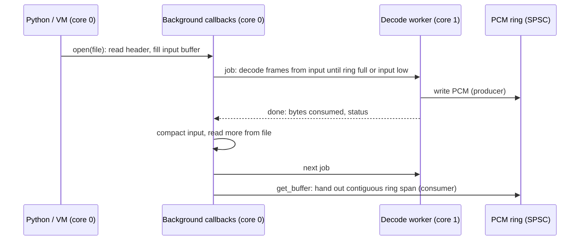

# Custom CircuitPython build: design

[Firmware docs](README.md) · [Architecture](architecture.md) · [Audio assets](audio-assets.md) · Issue [#29](https://github.com/dcuccia/digital-handbell/issues/29) · Evidence [#21](https://github.com/dcuccia/digital-handbell/issues/21)

**Status: design draft for owner review, November 24, 2026. Nothing here is
built.** No fork exists, nothing has been filed upstream, and the instrument
does not depend on any of this. Stock CircuitPython 10.3.2 (Pico UF2) with
16-bit WAV stays the working baseline.

Source claims cite `adafruit/circuitpython` at tag **10.3.2** (commit
`b443389e`) as `path:line`. Numbers are labelled **measured** (first article,
#21), **read** (from source) or **estimate** (not measured; do not rely on
them).

## 1. Summary

1. **What the source says about the dropouts.** Audio is pull-based. A DMA
   interrupt queues a background callback, and the callback calls
   `get_buffer` on core 0 between bytecodes (`ports/raspberrypi/audio_dma.c:507-567`).
   `MP3Decoder.get_buffer` decodes one whole MP3 frame inside that call
   (`shared-module/audiomp3/MP3Decoder.c:482`), and can also refill its
   input through the stream protocol there. The first decode happens
   synchronously inside `voice.play()`. Nothing is decoded ahead.
   Two different things can therefore exhaust the two-buffer DMA margin:
   **(a) callback scheduling delay** (core 0 not running background
   callbacks), which affects WAV equally, and **(b) decode cost** added
   inside the fill. WAV measured clean under the same load, which points
   at (b) or at (a)+(b) together. Decode-ahead and core 1 remove (b) only.
   Neither extends the deadline for (a): mixer fill and DMA reload still
   need core 0.
2. **A core-1 service is feasible and has precedent**, but the precedent is
   stricter than #29 assumed: both existing core-1 users forbid core 1 from
   touching flash at all, enforced by the MPU and a link-time check (section 4).
   An MP3 decoder on core 1 must either live in RAM or introduce a new
   pause-core-1-during-flash-writes mechanism. That is the main design
   decision (D3).
3. **"Any `AudioSample` on core 1" is not safe** and is not proposed. File
   samples call the VM stream protocol and FAT code; `synthio` and the mixer
   read Python-heap objects. The generic unit is narrower: a **pure decode
   step on RAM buffers** (section 5).
4. **The proposed shape needs no new Python API.** `MP3Decoder` decodes
   ahead into a ring. Where a port offers a free second core, the decode
   step runs there; otherwise it runs inline exactly as today. Graceful
   fallback is what makes it an upstream candidate.
5. **Cheaper steps come first and may be enough.** A decode-ahead ring on
   core 0 alone, native lead-in trim, and a board definition that turns off
   PicoDVI and USB host are each small, independently useful and
   upstreamable. Core 1 is step 4 of a ladder (section 3), gated on
   measurements.
6. **The fork is a patch stack on a release tag**, built by scripts that CI
   only calls, published as a UF2 pinned by SHA-256 in `toolchain.json`,
   with scheduled upstream tracking (section 9).

## 2. What the source establishes

| Topic | Finding (read) | Where |
|---|---|---|
| Audio fill path | DMA IRQ handler is RAM-resident and only queues `dma_callback_fun`; the callback loads the next block on core 0 | `ports/raspberrypi/audio_dma.c:507-567`, `:125-180` |
| MP3 decode | `MP3Decode` runs inside `get_buffer`, one frame per call, alternating between two PCM buffers of `MAX_BUFFER_LEN` = 576×2×2×2 = 4608 B each | `shared-module/audiomp3/MP3Decoder.c:26`, `:438-520`; `lib/mp3` at `aac02afd` `src/mp3dec.h` |
| Buffer lifetime | A returned buffer is still in use after `get_buffer` returns: `audio_dma` converts it afterwards, and a mixer voice keeps a pointer to the unconsumed remainder across fills. The advertised `max_buffer_length` (one frame) sizes the DMA buffers; a larger returned block raises "Internal audio buffer too small" | `audio_dma.c:40-48`, `:133-159`, `:225-268`; `shared-module/audiomixer/MixerVoice.c:66-82`; `MP3Decoder.c:399` |
| MP3 input | Compressed bytes are read through the VM stream protocol into a 2 KB linear buffer that is compacted with `memmove`. Refills happen both in background callbacks and synchronously from `get_buffer`'s sync-word helpers | `MP3Decoder.c:54-74`, `:122-200`, `:203-273`, `:290` |
| Reset and looping | `reset_buffer` rewinds only when input EOF is set; stereo single-channel output reuses one decoded frame through `other_channel` | `MP3Decoder.c:418-470` |
| Decoder memory | On RP2040 the Helix state comes from the Python heap (`m_malloc_maybe`); espressif overrides `mp3_alloc` to use the IDF heap | `shared-module/audiomp3/__init__.c:12`, `ports/espressif/common-hal/audiomp3/__init__.c` |
| Core-1 users | PicoDVI (RP2040) and PIO USB host each call `multicore_launch_core1` directly. There is **no runtime arbitration** between them | `ports/raspberrypi/common-hal/picodvi/Framebuffer_RP2040.c:276`, `common-hal/usb_host/Port.c:179` |
| Core-1 flash rule | Both set an MPU region making XIP flash execute-never on core 1: "After this, it will hard fault. Better than messing up CIRCUITPY" | `usb_host/Port.c:71-94`, `Framebuffer_RP2040.c:28-47` |
| Link-time check | `tools/check_core1_flash_calls.py` walks the static call graph from core-1 roots and fails the build if a reachable function is in flash. It does not trace indirect calls or data/table reads, and passes if a root is missing | `tools/check_core1_flash_calls.py:27-30`, `ports/raspberrypi/Makefile:812-841` |
| Core 1 to core 0 | `background_callback_add` and `port_wake_main_task` are RAM-resident so core 1 can queue work for core 0 and wake it | `supervisor/shared/background_callback.c:26-52`, `ports/raspberrypi/supervisor/port.c:660-672` |
| Flash writes | Erase and program go through one pair of hooks: interrupts off on core 0 and audio DMA **paused**. NVM writes use the same hooks | `ports/raspberrypi/supervisor/internal_flash.c:47-63`, `:101-109`; `common-hal/nvm/ByteArray.c:30-64` |
| Other XIP disruption | BOOTSEL-button sensing deselects the flash chip outside those hooks (called at startup for safe mode). CPU frequency changes and sleep entry do not pass through `audio_dma_reset` | `supervisor/port.c:706-757`, `common-hal/microcontroller/Processor.c:79-107`, `common-hal/alarm/__init__.c:194-261` |
| Core-1 faults | A hard fault on core 1 does not enter safe mode; core 1 spins in the handler and stops servicing interrupts | `supervisor/port.c:678-688` |
| Core-1 stack | `SCRATCH_X` (4 KB) is already reserved as the core-1 stack | `ports/raspberrypi/link-rp2040.ld:33`, `:295-298` |
| Stock Pico build | `CIRCUITPY_PICODVI = 1`, and `CIRCUITPY_USB_HOST` defaults to 1. PicoDVI "uses RAM to store code run on the second CPU for RP2040"; USB host keeps selected `usbh.o` and `tusb_fifo.o` code in RAM | `boards/raspberry_pi_pico/mpconfigboard.mk:12`, `mpconfigport.mk:30`, `:59-60`, `link-rp2040.ld:85` |
| WAV formats | `WaveFile` rejects anything but PCM, so ADPCM needs C work | `shared-module/audiocore/WaveFile.c:64-73` |
| Mixer buffers | `buffer_size` is split in two halves. Our 2048 B is two 512-sample halves, 23 ms each at 22.05 kHz mono | `shared-module/audiomixer/Mixer.c:27` |
| Host tests | `MP3Decoder.c` already has `MICROPY_UNIX_COVERAGE` shims; audio tests with `.exp` files exist for `audiofilter` and `WaveFile`. Playback tests are manual | `MP3Decoder.c:29-33`, `tests/circuitpython/`, `tests/circuitpython-manual/` |
| ESP32-S3 fill path | Same model: an I2S event queues a background callback that calls `get_buffer` | `ports/espressif/common-hal/audiobusio/__init__.c:27-125` |
| Custom builds | Upstream has a manual "Build board (custom)" workflow with a fork-compatibility path | `.github/workflows/build-board-custom.yml` |

One measured number lines up with the source: the 1106-sample lead-in trimmed
on the first article is one sample more than the usual 576-sample encoder
delay plus the 529-sample decoder delay (1105). This is consistent with
ordinary MP3 priming and suggests the trim can be derived from the file
(LAME/Xing header) rather than hand-tuned. It has not been verified against
our files' headers.

## 3. The ladder

Each rung is useful alone, and the next rung is started only if the
measurement at the previous one says it is needed.

| Rung | Change | Needs a custom build | Upstream candidate | Open measurement |
|---|---|---|---|---|
| 0 | Stock UF2, resident 16-bit WAV (in progress on #21) | No | n/a | - |
| 1 | **Board definition** `digital_handbell_rp2040`: pin names, PicoDVI and USB host off, optional frozen libraries | Yes | Yes, standard board PR | RAM and flash freed versus the Pico build |
| 2 | **Native MP3 lead-in trim** (gapless start) in `audiomp3` | Yes | Yes, small and self-contained | Onset latency versus WAV |
| 3 | **Decode-ahead ring on core 0**: `MP3Decoder` decodes into a PCM ring from background callbacks; `get_buffer` only hands out ring data | Yes | Yes, helps every port | Dropouts under the #21 load |
| 4 | **Core-1 decode worker**: the same ring, with the decode step executed on core 1 | Yes | Yes, if maintainers accept the flash policy (D3) | Dropouts, latency, RAM, soak |
| 5 | Optional **head cache**: play a pre-decoded first ~100 ms from RAM while the shared decoder catches up | Yes | Possibly | Onset latency with one shared decoder |

Alternative considered alongside, not on the ladder: **IMA ADPCM in
`WaveFile`**. Native decode is a few operations per sample, has no lead-in
and no bit reservoir, and is about 4x smaller than PCM (measured 44 KB for
the C5 note versus 32.6 KB as MP3). It would avoid the decoder-starvation
part of the problem (cause (b) in section 1, not (a)) without a second
core. It is lossy, its quality on bell
tones is unjudged, and drag-and-drop users would need to convert files. It
is also a plausible small upstream PR. Decision D2.

## 4. Core-1 concurrency and safety

### Rules (all models)

- Core 1 never calls the VM, never allocates or frees, never touches the
  filesystem, the stream protocol, `mp_printf` or any Python object.
- Core 1 works only on RAM buffers whose ownership was explicitly handed to
  it, and signals completion with `background_callback_add`, which is
  already core-1-safe.
- All buffers are allocated on core 0 when the decoder is constructed and
  are released only after the worker confirms it is idle.
- **An in-flight job is a GC root.** Priming starts before playback, when
  nothing but the Python variable references the decoder. The decoder is
  recorded in a registered root pointer (as `playing_audio` is,
  `audio_dma.c:600`) before a job is submitted, and removed only after the
  job has completed or been cancelled and its completion callback has
  retired. Core 1 writes only PCM and scalar decoder state; it never
  changes a pointer the collector follows.
- The worker is stopped, with a bounded wait, before: VM heap teardown
  (soft reload, Ctrl-D, safe mode), `deinit()`, deep or light sleep entry,
  `microcontroller.reset()` and CPU frequency changes. Sleep and frequency
  changes need their own hooks; they do not pass through `audio_dma_reset`.
- One core-1 owner at a time. A new `port` claim function arbitrates
  between PicoDVI, USB host and the audio worker, and raises the existing
  `"%q in use"` error. Today the first two launch core 1 unguarded; adding
  the guard is a small upstream fix on its own.
- If core 1 is unavailable (claimed, single-core port, feature compiled
  out), `MP3Decoder` runs the decode step inline on core 0. Behavior is
  then the same as rung 3.

### Ownership handoff instead of shared state

The compressed-input buffer is linear and compacted with `memmove`, so it
cannot be shared lock-free as it stands. The design passes ownership
instead:



- While a job is posted, core 1 owns the input buffer and the Helix state;
  core 0 does not touch them. When the job completes, ownership returns.
  This means `get_buffer` may no longer refill input or search for sync
  words itself; that work moves to the job-completion callback.
- The PCM ring is single-producer (core 1) single-consumer (core 0), made
  of **fixed slots of one decoded frame** (`max_buffer_length`, unchanged),
  so every returned block still fits the DMA buffers.
- **Handing out a slot does not free it.** Consumers keep using a buffer
  after `get_buffer` returns (section 2). Today a buffer stays valid until
  the second following call, because two buffers alternate. The ring keeps
  that exact contract: the two most recently handed-out slots stay leased
  and the producer may not write them. Index updates use release/acquire
  ordering.
- On underrun `get_buffer` returns one slot of silence and increments a
  counter; it never blocks.
- A job decodes several frames per handoff (2 KB of input is about 250 ms
  at 64 kbit/s), so the worker keeps filling the ring through a core-0
  stall. The ring cannot be *consumed* during such a stall (section 1).

State that must be explicit in the implementation, each with a host test:

| Case | Rule |
|---|---|
| `file =` / `open()` while a job runs | Cancel, wait for idle, then reset Helix state and the ring. Jobs carry a generation number; a completion from an older generation is ignored |
| End of file | Three separate states: input EOF, decode complete, ring drained. `GET_BUFFER_DONE` is returned only at the third |
| `reset_buffer` (looping) | Rewinds input without discarding slots that are still leased |
| Stereo with single-channel output | The `other_channel` pairing is kept per slot: both channel requests are served from the same slot before it is released |
| `deinit()` or object dropped mid-job | Root pointer keeps it alive; cancel and wait before freeing |

### The flash decision (D3)

| | Model A: RAM-resident worker, MPU lockout | Model B: worker runs from flash, paused for flash writes |
|---|---|---|
| Matches precedent | Yes, identical to USB host and PicoDVI | No, new mechanism |
| Enforcement | MPU fault plus `check_core1_flash_calls.py` with a new root. The checker misses indirect calls and table reads, so Helix's tables and any function pointers need a separate audit | Pico SDK multicore lockout (RAM-resident FIFO handler) called from `supervisor_flash_pre_write` / `post_write` |
| RAM cost | Helix code and tables move to RAM. **Estimate: tens of KB; to be read from the linker map** | About zero |
| Audible cost of a flash write | None added | Audio DMA is already paused for every write (read). The lockout handshake adds latency to each write; unmeasured |
| Failure mode | Missed function hard-faults core 1; audio falls back or stops, CIRCUITPY intact | A missed XIP-disrupting path makes core 1 fault. A faulted core 1 no longer answers the lockout, so an unbounded wait would **hang core 0**. Must be designed out (below) |
| XIP contention | None | Both cores fetch code over the same QSPI bus. Effect on core-0 speed unmeasured |
| RP2350 | Fits easily (520 KB RAM) | Same as RP2040 |

Recommendation: **prototype B on RP2040, keep the job interface identical
for A**, and take the choice to maintainers as an explicit question. With
about 24 KB free in the app (measured), Model A is unlikely to fit on
RP2040 unless the map shows Helix is much smaller than estimated or rung 1
frees enough RAM. A hybrid (only the hot inner loops in RAM) is possible
but still breaks the "nothing in flash" rule.

Model B requirements:

- **Paths that must quiesce core 1 (read):** the CIRCUITPY sector flush
  and NVM writes, both through `supervisor_flash_pre_write`; BOOTSEL
  sensing (`supervisor/port.c:706-757`, reached at startup before a worker
  exists, an ordering assumption to state in code); CPU frequency changes;
  sleep entry. The RDID command in `supervisor_flash_init` also runs
  before any worker exists.
- **Worker states:** stopped, ready, running, faulted. The lockout is
  requested only in ready/running, and the audio worker owns the
  inter-core FIFO exclusively.
- **Bounded waits, never a write on failure.** If core 1 does not
  acknowledge within a bound, core 0 forces it into reset
  (`multicore_reset_core1`, a state known to be quiescent), marks the
  worker faulted, and only then touches flash. Decode falls back to inline.
- The pinned SDK's lockout initiator polls the FIFO rather than relying on
  a core-0 interrupt, so calling it with core-0 interrupts disabled is
  plausible (pico-sdk `a1438dff`, `pico_multicore/multicore.c:218-325`).
  Confirm on hardware in the spike.

### Sleep, reset, and coexistence

- **Deep sleep** (`alarm.exit_and_deep_sleep_until_alarms`, DORMANT): the
  handbell already shuts audio down first; the worker is stopped in the
  same step. Waking is a reset, so nothing resumes.
- **Idle power:** the worker waits in `__wfe` with no job. Added idle
  current is unmeasured.
- **PicoDVI / USB host:** mutually exclusive with the worker at run time.
  A build may contain all three; whichever claims core 1 first wins and
  MP3 falls back to inline decode.
- **`cpu.frequency`:** the worker is parked across clock changes.

## 5. API shape and placement

**Proposal: no new module and no required API change.** Placement:

| Layer | Where | What |
|---|---|---|
| Core-1 claim and job runner | `supervisor/port.h` hooks, implemented in `ports/raspberrypi/supervisor/` | `port_aux_core_claim/release`, `submit(job)`, `stop()`. Weak defaults report "unavailable", so other ports need no change |
| Decode-ahead ring | `shared-module/audiomp3/MP3Decoder.c` | Ring replaces the two fixed PCM buffers; decode step factored into a function with no VM calls |
| Python surface | `shared-bindings/audiomp3/MP3Decoder.c` | Existing constructor, `file`, `open()`, `samples_decoded` unchanged |

Optional additions, each justified by a measurement before it is proposed:

```python
decoder = audiomp3.MP3Decoder(file, buffer)        # unchanged
decoder = audiomp3.MP3Decoder(file, buffer, gapless=True)   # rung 2: skip encoder + decoder delay
decoder.buffered   # read-only: samples ready in the ring (diagnostics, tests)
decoder.underruns  # read-only: times get_buffer had to return silence
decoder.open(file, head=pcm_bytes)                 # rung 5: caller-supplied first samples
```

Why not the alternatives:

- **A generic wrapper (`BufferedSample(any_sample)`)** on core 0 is
  reasonable and could be offered later, but on core 1 it would call
  arbitrary `get_buffer` implementations that touch the VM. Not safe.
- **`_thread`** exposes the whole VM to two cores. Out of scope, and not
  something upstream has shown interest in for this port.
- **A handbell-only module** has no upstream path and maximum maintenance.

The ring reuses the caller's `buffer` argument when it is large enough, as
today (`MP3Decoder.c:303-340`), so RAM stays under application control.

## 6. RAM budget (RP2040)

| Item | Bytes | Basis |
|---|---|---|
| Free heap in the running app, one MP3 decoder | ~24,000 | measured |
| One MP3 decoder today (Helix state + 2 KB input + 2×4608 B PCM) | ~37,000 | measured |
| PCM ring, if it replaces the two PCM buffers: 9216 B is 8 one-frame slots at 22.05 kHz mono (209 ms; 2 slots stay leased, so about 157 ms ahead). At 44.1 kHz stereo the same bytes are only 2 slots, so decode-ahead there needs a larger caller buffer | 0 net at our format | read + arithmetic |
| Core-1 stack | 0 net if Helix fits the reserved 4 KB | read; Helix stack depth unmeasured |
| Job runner state and RAM-resident loop | < 1,000 | estimate |
| Head cache, per resident note, 100 ms | 4,410 | arithmetic |
| Model A only: Helix code + tables in RAM | tens of KB | estimate, read from map in spike |
| Rung 1: PicoDVI and USB host removed | frees RAM | read that both hold code in RAM; amount unmeasured |
| Rung 1 option: freeze `adafruit_lsm6ds`, `adafruit_register`, `adafruit_bus_device` | frees heap | estimate; libraries stay unmodified, built from the pinned commits |

The second MP3 decoder (for overlapping re-strikes) remains a 37 KB
question that this design does not answer; the head cache targets instant
onset with one shared decoder instead.

## 7. Latency approach

Contributors to strike-to-sound on the MP3 path, and what addresses each:

| Contributor | Size | Addressed by |
|---|---|---|
| MP3 lead-in | 1106 samples = 50.2 ms at 22.05 kHz (measured) | Rung 2 trim: decode and discard instead of playing |
| First-frame decode at strike | one to three frames of decode time (unmeasured) | Ring already primed when `open()` returns; rung 5 head cache when the decoder is shared |
| Mixer queueing | 23-46 ms at `buffer_size` 2048, 12-23 ms at 1024 (estimate from buffer math) | Smaller mixer buffer becomes viable once decode no longer competes with the fill callback |
| Amplifier power-up | ~55 ms cold; pre-wake hides it (architecture doc) | Unchanged |

Priming rule: decode-ahead starts when the file is set, not when `play()`
is called. A decoder that is opened on the selected bell during pre-wake
has PCM waiting at the strike. With one shared decoder and two resident
notes, the note that is not currently open pays the open cost at strike
time unless it has a cached head; that is the case rung 5 exists for.

Everything in this section needs the same-timebase bench from #21 (GPIO13
marker) before any number is quoted as a result.

## 8. Board definition scope

`ports/raspberrypi/boards/digital_handbell_rp2040/`, modelled on
`raspberry_pi_pico` and the Prop-Maker Feather naming:

| File | Content |
|---|---|
| `mpconfigboard.mk` | `CHIP_VARIANT = RP2040`, `EXTERNAL_FLASH_DEVICES = "W25Q16JVxQ"`, `CIRCUITPY_PICODVI = 0`, `CIRCUITPY_USB_HOST = 0`, USB identity (D5), optional `FROZEN_MPY_DIRS` (D6) |
| `mpconfigboard.h` | Board name, `CIRCUITPY_BOARD_I2C` on GPIO3/GPIO2, single-colour status LED on GPIO13 (D7) |
| `pins.c` | `SDA`, `SCL`, `IMU_INT1` (GPIO22), `I2S_DATA`/`I2S_BIT_CLOCK`/`I2S_WORD_SELECT` (16/17/18, the Prop-Maker names), `BUTTON` and `EXTERNAL_BUTTON` (GPIO19), `AMP_MUTE` (GPIO20), `POWER` and `EXTERNAL_POWER` (GPIO23), `LED` (GPIO13), `I2C()`/`STEMMA_I2C()`, plus `GPxx` aliases |
| `board.c` | Empty. The board's pull resistors (R20 mute high, R17 power low) already give the safe state; firmware drives nothing at board init, matching today's Pico build |
| `pico-sdk-configboard.h` | Empty |

Not in scope: changing default module sets beyond the two core-1 users,
battery-sense pins (next hardware revision, #17), or any behavior in
`board.c`.

App impact: `platforms/__init__.py` selects the profile by
`board.board_id` (the one-line change the architecture doc anticipates).
The app keeps using `microcontroller.pin.GPIOxx`, so it runs unchanged on
both the stock Pico UF2 and the custom UF2.

## 9. Fork, repository layout and CI

### Layout

Sibling GitHub fork `dcuccia/circuitpython` (a true fork is required to
open upstream PRs). Not created until approved (D1).

| Branch | Base | Purpose |
|---|---|---|
| `main` | upstream `main` | Mirror only; never committed to |
| `pr/<topic>` | upstream `main` | One per upstream PR candidate: `board-digital-handbell`, `core1-claim`, `mp3-gapless`, `mp3-decode-ahead`, `mp3-aux-core` |
| `handbell/<tag>` e.g. `handbell/10.3.2` | upstream release tag | Integration: the tag plus the patch stack plus `tools/handbell/` and `handbell-*.yml`. Tagged `10.3.2-handbell.N` |

The integration base follows the CircuitPython version pinned in
`firmware/toolchain.json`, because `mpy-cross` and the library bundle must
match it. Upstream PRs must target `main` (currently 11.0 beta), so each
topic exists on two bases. That double maintenance is a real cost
(section 13).

Fork-only files live under new names so they never conflict with upstream:
`tools/handbell/*.py` and `.github/workflows/handbell-*.yml`. Upstream's
own workflows stay disabled in the fork.

### Scripts (CI only calls them)

| Script | Does |
|---|---|
| `tools/handbell/build.py` | Fetches submodules for the port, builds the board, writes `firmware.uf2`, its SHA-256, the map-derived RAM/flash report and a provenance JSON (base tag, patch commits, toolchain versions) |
| `tools/handbell/test.py` | Builds the unix coverage port and runs the audio host tests (section 11) |
| `tools/handbell/track_upstream.py` | Detects new upstream tags; rebases the patch stack onto the new tag in a new branch; reports clean / conflict; summarises upstream changes under the watch paths |
| `tools/handbell/release.py` | Publishes the UF2 and reports as a GitHub release on the fork, from a tag |

Watch paths: `ports/raspberrypi/audio_dma.c`, `supervisor/internal_flash.c`,
`supervisor/port.c`, `common-hal/usb_host/Port.c`, `common-hal/picodvi/`,
`Makefile`, `link-rp2040.ld`, `tools/check_core1_flash_calls.py`,
`shared-module/audiomp3/`, `shared-module/audiocore/`,
`supervisor/shared/background_callback.c`, and the `lib/mp3` and `sdk`
submodule pins.

### Workflows

| Workflow | Trigger | Steps |
|---|---|---|
| `handbell-build` | push to `handbell/*` and `pr/*`, PRs | `build.py`, `test.py`, upload artifacts |
| `handbell-track` | weekly schedule, manual | `track_upstream.py`; on a new stable tag opens a PR for `handbell/<new tag>`; on conflict opens an issue with the conflict list and the watch-path summary |
| `handbell-release` | tag `*-handbell.*` | `release.py` |

### Agentic options

| Level | What the model does | Guardrail |
|---|---|---|
| 0 Standard | Nothing. Scripts rebase and report | - |
| 1 Assess | A workflow step asks a model to summarise the upstream diff under the watch paths and rate the risk to each patch; posts it on the tracking PR or issue | Read-only; output is advisory |
| 2 Implement | On conflict or failed build, the tracking issue is assigned to a coding agent, which opens a PR against the new `handbell/<tag>` branch | Never tags, releases, or touches `pr/*` branches; a person reviews and merges |

In every level, a release becomes the instrument's firmware only through a
PR in digital-handbell that updates `toolchain.json` (URL and SHA-256), and
that PR needs the bench checklist in section 11. CI cannot run the bench.

### Consumption in digital-handbell

`toolchain.json` gains a second UF2 entry beside `raspberry_pi_pico`
(`digital_handbell_rp2040`: URL of the fork release asset, SHA-256, source
commit and base tag). `package.py` and `deploy.py` pick the UF2 by an
explicit option, defaulting to stock until the owner switches it. The
firmware CI runs its tests the same way for both.

## 10. ESP32-S3 mirroring path

- The Python surface and `MP3Decoder` ring are shared code, so they carry
  over unchanged. Only the `port_aux_core_*` hooks are new per port.
- On espressif the hooks become a FreeRTOS task with a queue. The core
  assignment relative to the CircuitPython task must be read from the port
  before it is designed; not verified here.
- No flash lockout work is expected: ESP-IDF already coordinates flash
  operations across cores. To be confirmed in the port, not assumed.
- `mp3_alloc` already uses the IDF heap there, so decoder state is off the
  VM heap.
- With PSRAM, a whole decoded note (177 KB for 4 s) fits in RAM. On that
  board the simplest design may be decode-once-to-RAM with the same ring
  code and a ring as long as the note, which makes the worker optional.
- The board definition is separate work once S3 hardware exists.

## 11. Test and bench strategy

**Host (CI, unix coverage port)**

- Bit-exact equivalence: PCM from ring mode equals PCM from today's inline
  path for a set of MP3 fixtures (mono/stereo, 22.05/44.1 kHz, with and
  without ID3 and LAME headers). Decode is deterministic, so this is the
  main regression guard.
- Gapless: trimmed output aligns sample-exactly with a reference decode.
- Ring and handoff logic compiled for the host with a pthread standing in
  for core 1, run under ThreadSanitizer with randomized stalls.
- The state cases in section 4: file replaced mid-job, files shorter than
  the ring, looping, stereo split-channel output, object dropped mid-job
  followed by a collection, and buffer contents unchanged while leased.
- Fallback: with the aux core "claimed", output is still bit-exact.

**Build-time**

- `check_core1_flash_calls.py` with the worker root (Model A), or a check
  that every flash-write path takes the lockout (Model B).
- RAM and flash deltas against the stock Pico build, failed by threshold.

**On-device (manual, recorded per release candidate)**

| Test | Compare |
|---|---|
| Dropouts under the #21 load (IMU reads + `gc.collect()` every 0.5 s), 3+ notes, phone recording analysed the same way | stock WAV, stock MP3, each rung |
| Strike-to-onset on one timebase, GPIO13 marker, p50/p95, cold and warm, repeat and alternating strikes | same |
| Flash stress while playing: file writes from code, host writes over USB MSC, NVM writes | no fault, no corruption (`fsck` the drive image afterwards) |
| Lifecycle soak: soft reload ×100 mid-note, Ctrl-C mid-note, safe mode entry, deep sleep and wake ×50, `cpu.frequency` change | no hang, worker restarts |
| Free heap and loop-rate status lines | against stock |
| Safety contract: muted and unpowered at boot, mute → stop I2S → POWER off on every exit path including faults | unchanged from stock |

**Regression against stock:** the handbell test suite and bring-up scripts
run unchanged on both UF2s; any difference is a blocker.

## 12. Upstream engagement path

Nothing below happens without owner approval for that step.

1. **Ask before building much.** One GitHub issue on `adafruit/circuitpython`
   with the measured dropout evidence and a short proposal (decode-ahead
   ring; optional second-core execution; the Model A/B question). Ask
   whether maintainers want it and in what form. The weekly meeting and
   the `#circuitpython-dev` Discord channel are the other venues.
2. **Small PRs in dependency order**, each useful alone:
   1. core-1 claim/arbitration for PicoDVI and USB host (fixes an existing
      unguarded double launch);
   2. `audiomp3` gapless start;
   3. decode-ahead ring, inline on all ports, with host tests;
   4. aux-core execution on raspberrypi;
   5. espressif.
3. **Board definition PR** separately, when the owner is ready for the
   board to be public in that form. It needs a unique USB VID/PID
   (`tools/ci_check_duplicate_usb_vid_pid.py` enforces uniqueness) and
   normally a circuitpython.org board page.
4. **Licensing:** new code MIT with SPDX headers as upstream does;
   `lib/mp3` (Helix) is not modified.
5. Disclose AI assistance in PR descriptions; a person reviews and stands
   behind each PR. No AI-contribution policy was found in the tagged tree;
   check current maintainer guidance before filing.

If maintainers decline second-core audio, rungs 1-3 are still candidates,
and rung 4 stays a fork-only patch or is dropped.

## 13. Maintenance cost and exit plan

Estimated patch stack (estimates, not counted code):

| Patch | Size | Conflict exposure |
|---|---|---|
| Board definition | ~150 lines, new directory | Very low |
| Core-1 claim | ~60 lines in three files | Low |
| MP3 gapless | ~120 lines in `audiomp3` | Low |
| Decode-ahead ring | ~250 lines in `audiomp3` | Medium: active file |
| Aux-core worker (raspberrypi) | ~300 lines in port + supervisor | Medium to high: `port.c`, `internal_flash.c`, `Makefile` changed for core-1 work in the last year |
| Tooling and workflows | fork-only files | None |

Recurring cost per upstream release: a rebase, a build, the host tests and
the bench checklist. Patches 1-3 should rebase mechanically; 4-5 will
sometimes need hand or agent work. Each merged upstream PR removes a patch.

Exit, at any time and without hardware changes:

- The app feature-detects (`board.board_id`, `hasattr`), so the same
  firmware zip runs on the stock Pico UF2.
- `toolchain.json` keeps the stock UF2 entry; switching back is one option.
- The fork can shrink to the board definition only, or be archived.

Stop conditions for rung 4: no dropout improvement over rung 3 on the
bench; RAM cost that removes the resident-note headroom; any CIRCUITPY
corruption or unrecoverable hang in the flash-stress or lifecycle soak;
or maintainers rejecting the approach while the fork-only cost looks
higher than staying on WAV.

## 14. Proposed bounded next items

No fork or public artifact is needed for 1-3.

1. **Stock-firmware measurements** (first article): MP3 decode share of
   CPU (loop-rate drop while an MP3 plays), dropouts at 200 MHz, dropouts
   with a larger mixer buffer, and how long the longest background-callback
   gap is under the #21 load. These separate cause (a) from cause (b) in
   section 1. If (a) dominates, neither rung 3 nor rung 4 fixes it and the
   remedy is in the app loop or buffer sizes; if (b) dominates, they say
   how much rung 3 can recover without core 1.
2. **Local build spike** (private clone, Linux/WSL, not pushed): build
   stock Pico 10.3.2 and the board definition; diff RAM/flash from the
   maps; read Helix code and table sizes for the Model A estimate.
3. **Rung 2+3 prototype** in the same private clone with host tests; bench
   on the first article.
4. Decide on rung 4 and on opening the upstream conversation.

## 15. Owner decisions

| ID | Decision | Options | Recommendation |
|---|---|---|---|
| D1 | Create the fork now? | Now / after next items 1-3 in a private local clone | After: nothing public is needed to learn whether core 1 is required |
| D2 | Compressed format to invest in | MP3 ladder / native IMA ADPCM in `WaveFile` / both | MP3 ladder first (keeps drag-and-drop MP3); judge ADPCM quality on the host in parallel since it costs nothing on the device |
| D3 | Core-1 flash policy | A (RAM-only, precedent) / B (lockout) / ask upstream first | Prototype B, ask upstream before investing in either |
| D4 | Integration base | Pinned stable (10.3.2) / 11.x | Pinned stable, with `pr/*` branches on upstream `main` |
| D5 | USB identity for the custom UF2 | Private builds reuse an existing ID / obtain a unique PID (e.g. pid.codes) now / defer public UF2 | Obtain a unique PID before any UF2 is published; needed for an upstream board PR anyway |
| D6 | Freeze the three Adafruit libraries into the UF2 | Yes / no | Measure in the build spike; yes if it frees meaningful heap. Libraries stay unmodified |
| D7 | GPIO13 as CircuitPython status LED | Yes (blink codes without USB) / no | Yes, after confirming the app can still claim the pin |
| D8 | Agentic level for upstream tracking | 0 / 1 / 2 | Start at 1; move to 2 after a few uneventful releases |
| D9 | When to open the upstream conversation | After stock measurements / after a working prototype / not yet | After next item 1, with the evidence and before much code |
| D10 | Board PR upstream | Now / when the hardware revision settles / never | When the hardware revision settles; the pin map may change with #17 |
