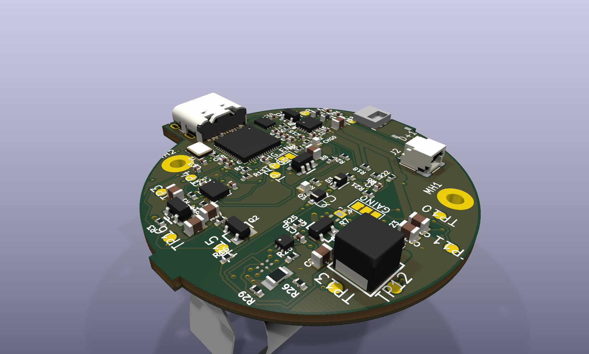
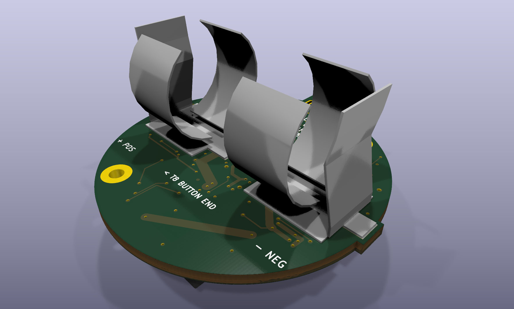

# Digital Handbell project pages

A rechargeable, motion-triggered musical instrument in a 3D-printed bell,
developed in the open. The first prototype PCBA batch has been ordered.

| Front: electronics | Back: battery clips |
|:---:|:---:|
|  |  |

*KiCad renders of public PCB `2f738ccb`, not photographs. The battery
clips and J1 speaker connector are simplified project proxies; this is a
design aid, not a fit, electrical, manufacturing or safety qualification.*

**[Rotate and zoom the PCBA in 3D](3d/)**

- [Build a handbell: parts, printing, speaker harness and assembly](build-a-handbell.html)
- [Design gallery](design-gallery.html)
- [Project roadmap](roadmap.html)
- [Source repository and project README](https://github.com/dcuccia/digital-handbell)
